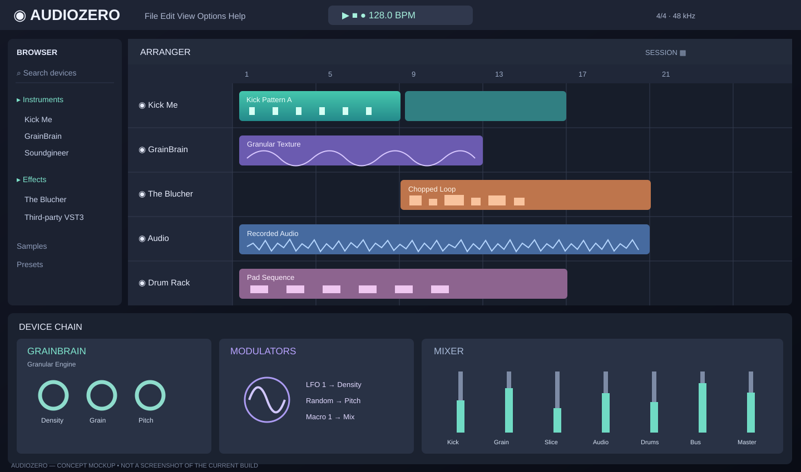

# AudioZero

**NOISYLOOP's native modular C++ digital audio workstation.**

> **Status:** macOS VST3 host proof of concept. The image below is a **concept mockup**, not a screenshot of the currently running application.



AudioZero aims to combine Ableton-style arrangement and clips, Bitwig-inspired modulation, MPC-style sampling and standard third-party VST3 hosting. MusicLab remains the separate browser-based lite DAW.

## Current build

[PR #1](https://github.com/noisyloop/AudioZero/pull/1) introduces a JUCE/C++20 Mac host with basic VST3 loading, plugin editor, MIDI/audio device integration and state save/restore. Its GitHub Actions macOS compilation and unsigned app artifact upload **passed**.

**This does not yet prove any VST3 plugin works at runtime.** We still need to load each plugin on a Mac, exercise MIDI/audio, and verify state roundtrips. The concept interface shown above has not been implemented.

| Plugin | Host compilation | Plugin loading | Audio/MIDI | State recall |
| --- | --- | --- | --- | --- |
| Kick Me | Passed | Untested | Untested | Untested |
| GrainBrain | Passed | Untested | Untested | Untested |
| The Blucher | Passed | Untested | Untested | Untested |
| Third-party VST3 | Passed | Untested | Untested | Untested |

## Mac build and validation

Prerequisites: Xcode, CMake, and internet access to fetch JUCE.

```bash
bash scripts/build-mac.sh
bash scripts/check-mac-plugins.sh
```

The second script inventories local VST3 bundles, executable architectures and code signatures. **It does not execute plugins or prove compatibility.** See [the manual test checklist](docs/TESTING.md).

## Roadmap

1. **Plugin host:** load VST3, open editor, MIDI/audio routing, save/restore state.
2. **DAW core:** transport, tracks, clips, piano roll, mixer, persistence, WAV export.
3. **Creative workflow:** clip launcher, 16-pad sampler, slicing, modulation and automation.
4. **Release quality:** plugin isolation, latency compensation, crash recovery, signed installers.

## Commercial licensing

AudioZero is intended to be proprietary commercial software. No open-source license is granted for this repository. Review JUCE's commercial licensing requirements before distributing a product. Third-party plugins retain their own licenses.

This repository is private. The UI concept is original prototype artwork, not a product screenshot.
