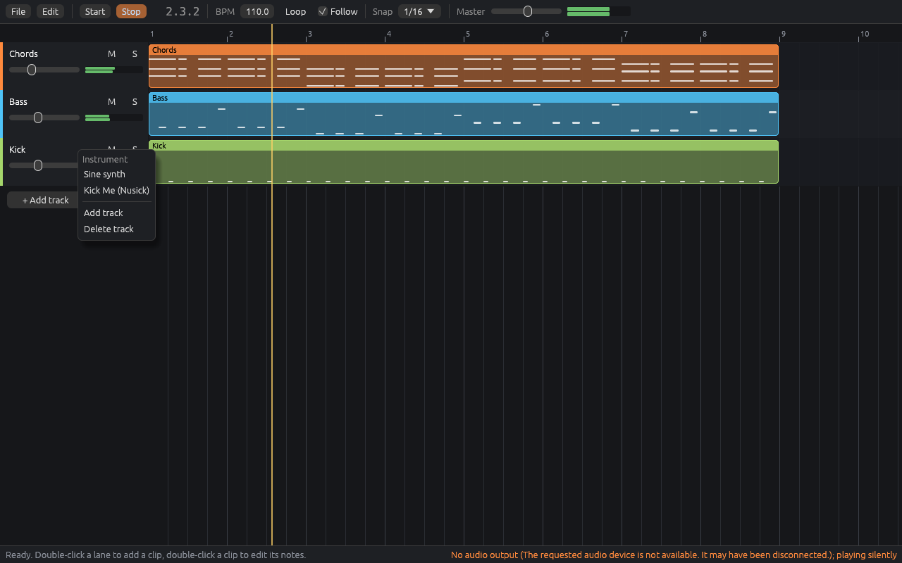
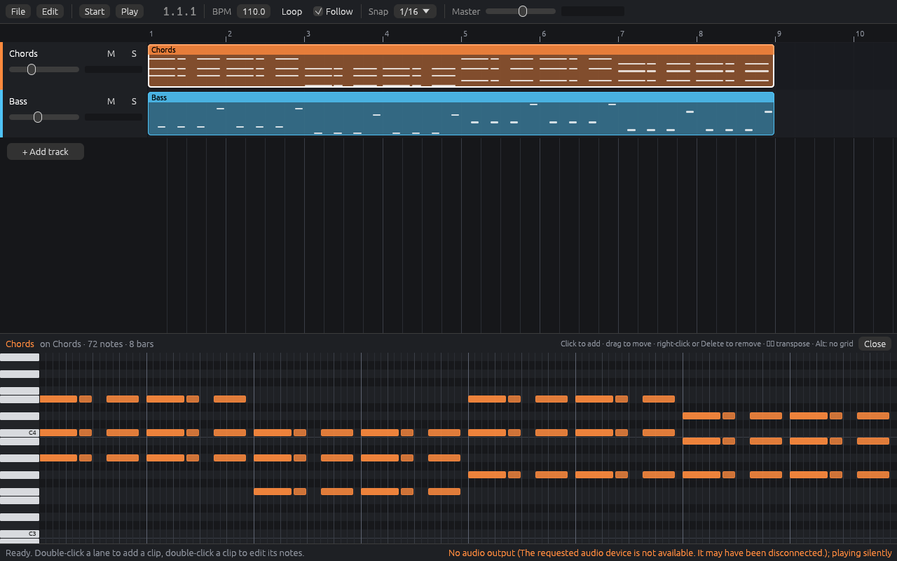

<p align="center"></p>

# AudioZero

**NOISYLOOP's native C++ digital audio workstation.** It's built with JUCE: one codebase for macOS, Windows and Linux.


*Real screenshot of the current build with the built-in demo song. The bottom panel shows Operator on the "Chords" track.*

| Piano roll | Mixer |
| --- | --- |
|  |  |

## What's in this build

- **Arrangement view** (Ableton / Bitwig / FL style)
  - Tracks with mute, solo, arm, volume and meters.
  - A bar ruler with a draggable loop brace.
  - Snap grid, zoom (Cmd/Ctrl + wheel or pinch) and a follow-playhead option.
  - Clips:
    - Double-click an empty lane to create a MIDI clip.
    - Drag to move, also across tracks. Drag the edges to trim. Alt-drag copies.
    - Split, duplicate, copy/paste, rename, colour and mute.
  - Every edit can be undone and redone.
- **Bring your own content**
  - Drag your **audio files** (wav, aif, flac, mp3, ogg) or **MIDI files** from Finder/Explorer onto a track. You can also drag them from the browser's sample folders, where clicking a sample previews it.
  - Drag a **`.vst3` bundle** straight onto a track or the device chain. Instruments go into the instrument slot and effects are added to the chain.
  - Scanned plugins appear in the browser, where you can drag them or double-click them.
  - Dropping anything below the last track creates a new track.
- **Operator**, a built-in 4-operator FM synth:
  - 8 algorithms with a live diagram.
  - Per operator: waveform, coarse/fine ratio, level, velocity and an ADSR envelope.
  - Feedback.
  - A low/high/band-pass filter with its own envelope.
  - An LFO that can modulate pitch, filter, volume or FM amount.
  - A pitch envelope for kicks and zaps.
  - 16 voices, sustain pedal, and 10 presets.
  - It also builds as a **standalone VST3 plugin** ("AudioZero Operator") you can use in other DAWs.
- **Built-in effects:** Reverb and a stereo/ping-pong Delay.
- **Piano roll**
  - Click to draw notes. Drag to move or resize.
  - Right-click or double-click deletes a note. Shift-drag selects.
  - Alt-drag copies. Q quantizes. Up/Down transposes. There's a velocity lane.
- **Mixer** with volume, pan, mute, solo and meters on every track and the master.
- **Transport**
  - Play/stop, loop, metronome, and tempo/time signature (drag or double-click to type).
  - MIDI recording from hardware controllers or the **computer keyboard**: A-K play notes, Z/X change octave, C/V change velocity.
- **Projects** save as `.azproj` (XML, with plugin state). Audio generated in memory is saved next to the project. **Export to WAV** renders offline.
- Hosted plugins receive tempo, position, play state and loop points, so tempo-synced effects work. Every MIDI input is enabled automatically.

See **Help > Keyboard Shortcuts** in the app for the full list.

## Your own VST3 plugins

AudioZero hosts VST3 through JUCE, so plugins built with JUCE work, for example Kick Me, GrainBrain and The Blucher. There are three ways to add one:

1. Drag the `.vst3` from Finder/Explorer onto a track or onto the bottom device panel.
2. Click **Scan Plugins** in the browser. To add your own build folder, use **Add Folder... > Add VST3 plugin folder**.
3. Click **+ Add Effect** / **Choose Instrument...** in the device panel and pick **Browse for a .vst3 file...**.

Click **Open Editor** on a plugin's device card to show its own UI. Plugin state is saved inside the project.

The test suite checks this path by building the Operator VST3, then loading it through AudioZero's host. The test plays a MIDI clip with it, saves the project and reloads it.

## Building

All platforms fetch JUCE 8.0.10 automatically, which needs internet access the first time.

| Platform | Requirements | Command |
| --- | --- | --- |
| macOS | Xcode, CMake | `bash scripts/build-mac.sh` |
| Windows | Visual Studio 2022 or newer (C++ workload), CMake | `powershell scripts/build-windows.ps1` |
| Linux | CMake, Ninja, ALSA/X11/freetype dev packages (listed in the script) | `bash scripts/build-linux.sh` |

Each build produces:

- the app, `AudioZero(.app/.exe)`;
- the plugin, `AudioZero Operator.vst3`, plus a standalone Operator app;
- the test runner, `AudioZeroCoreTests`.

`scripts/screenshots.sh` regenerates the README screenshots from the real app. Under the hood it runs `AudioZero --screenshot out.png --tab devices|pianoroll|mixer`.

`resources/icon.png` is a placeholder icon generated by `scripts/make-icon.py`. Replace the PNG with your own; CMake turns it into the `.icns` and `.ico` files.

## Rust rewrite (early)

AudioZero is moving to Rust so it no longer depends on JUCE. The Rust workspace sits next to the C++ app, which stays the working build until the Rust one can replace it.



*The Rust app playing the built-in demo song. It was captured on a machine with no sound card, so the status bar says it's playing silently.*

What works so far:

- **The window:** the arrangement view (tracks, clips with a preview of their notes, bar ruler, playhead), play/stop, tempo, loop, snap, master volume and per-track mute, solo and volume with level meters.
- **Clip editing:** click to select, drag to move (also onto another track), drag the right edge to resize, double-click an empty lane to add a clip, and right-click for Edit notes, Duplicate, Mute and Delete. Add tracks with **+ Add track** and remove them by right-clicking a track's header.
- **Piano roll:** double-click a clip to edit its notes:
  - click to add a note, or drag from an empty spot to draw one at the length you want;
  - drag notes to move them, and drag a note's right edge to change its length;
  - Shift-click to select several notes, Ctrl/Cmd + A to select all;
  - right-click or Delete to remove, Up/Down to transpose (Shift moves an octave).
- **Grid:** snap to bars, 1/4, 1/8, 1/16 or 1/32, or turn it off. Holding Alt ignores the grid.
- **Undo:** every clip, note and track edit can be undone and redone (Ctrl/Cmd + Z, Ctrl/Cmd + Shift + Z or Ctrl + Y). A whole drag is one step. Mixer and tempo changes aren't undo steps, and undoing an edit leaves them as they are.
- **Editing while playing:** an edit swaps in just that track's clips, so playback carries on. Adding or removing a track rebuilds the engine and keeps the playhead where it was. Every edit gets the same validation as a project file.
- **Navigation:** click or drag the ruler to move the playhead; Ctrl/Cmd + wheel or pinch zooms; the wheel scrolls (Shift for sideways).
- **Shortcuts:** Space plays and stops, Home goes back to the start, Ctrl/Cmd + S saves, Ctrl/Cmd + O opens, Ctrl/Cmd + D duplicates the selected clip.
- **Projects:** open, save and save-as (`.json`), drag a project onto the window to open it, and AudioZero asks before throwing away unsaved changes.
- **No sound card:** the app still runs, and the playhead moves without sound.



| Crate | What it is |
| --- | --- |
| `crates/audiozero-engine` | The audio engine and project format, with no UI or platform code. Projects are JSON, and every project is checked against fixed limits and ranges before the engine sees it. Rendering is sample-accurate. The audio thread never allocates, frees, locks or waits: the UI sends commands through a lock-free queue, and a new project is built on the UI thread and swapped in whole. Includes a small built-in sine synth and a demo song. |
| `crates/audiozero-host` | Finds CLAP and VST3 plugins and resolves projects' plugins by identity, never by a path stored in the project. It doesn't load plugin code yet; that will happen in a separate process. |
| `crates/audiozero-app` | The `audiozero` app: the window, plus command-line options to play, render to WAV, save the demo project or list installed plugins. |

```sh
cargo run --release -p audiozero-app                          # open the window with the demo song
cargo run --release -p audiozero-app -- song.json             # open a project
cargo run --release -p audiozero-app -- --play                # play from the command line, no window
cargo run --release -p audiozero-app -- --render demo.wav     # render to WAV
cargo run --release -p audiozero-app -- --save demo.json      # write the demo as a project file
cargo run --release -p audiozero-app -- --scan                # list installed CLAP/VST3 plugins
cargo test --workspace                                        # all tests
```

On Linux, building needs the ALSA headers (`libasound2-dev`), and running the window needs an OpenGL driver and `libxkbcommon-x11-0`. Desktop installs normally already have them. The direct dependencies are `serde`/`serde_json` (project files), `rtrb` (the lock-free command queue), `cpal` (audio output) and `eframe`/`egui` (the window).

## Continuous integration

Every build is manual for now: pushes, pull requests and merges don't start any workflow. To build, open **Actions**, pick a workflow, click **Run workflow** and choose the branch.

| Workflow | Runs on | What it does |
| --- | --- | --- |
| `rust.yml` | Linux | Rust workspace: format check, Clippy, tests, demo render (about a minute) |
| `ci.yml` | Windows + Linux | C++ app: build, all tests, app + VST3 artifacts, Linux UI screenshot |
| `mac-build.yml` | macOS | C++ app: build, all tests (including the VST3 host smoke test), unsigned DMG, Operator VST3 artifact |

macOS minutes count 10x against the GitHub Actions allowance, so run `mac-build.yml` only when you need a Mac build.

## Status and known limitations

This is an early but working DAW. Not done yet:

- No audio input recording; MIDI recording works.
- No automation lanes, clip launcher (session view) or time-stretching. Audio clips play at their original speed.
- Plugins run in the same process, so a crashing plugin crashes AudioZero. Sandboxing is planned.
- No plugin delay compensation.
- Only VST3 is hosted (no AU yet).
- Undo covers arrangement edits. Device add/remove isn't undoable yet.
- The macOS and Windows builds are unsigned.
- MCP / AI control isn't started yet. The `Session` class holds every editing operation (add track, create clip, load a device, and so on) in one place, which is where an MCP server would plug in.

## Roadmap

1. **Hardening:** trust plugins by identity instead of the path in the project file, validate project and audio input, plugin sandboxing, latency compensation, crash recovery and autosave, signed installers. See [docs/SECURITY_REVIEW.md](docs/SECURITY_REVIEW.md) for the findings and the prioritised plan.
2. **Workflow:** automation, clip launcher, audio recording, warping, sampler and drum rack, more built-in effects.
3. **MCP server:** expose `Session` operations so an assistant can build and edit songs.

## Related projects

- [Nusick](https://github.com/noisyloop/Nusick): NOISYLOOP's MIT-licensed Rust framework for audio plugins, home of the Kick Me kick synth.

## License

AudioZero's own source code is released under the [MIT License](LICENSE).

AudioZero is built on [JUCE](https://juce.com), which has its own license: JUCE 8 is available under the AGPLv3 or a commercial JUCE license. The MIT License covers the code in this repository. Builds you distribute, which link JUCE, also have to meet JUCE's terms. Third-party plugins keep their own licenses.
