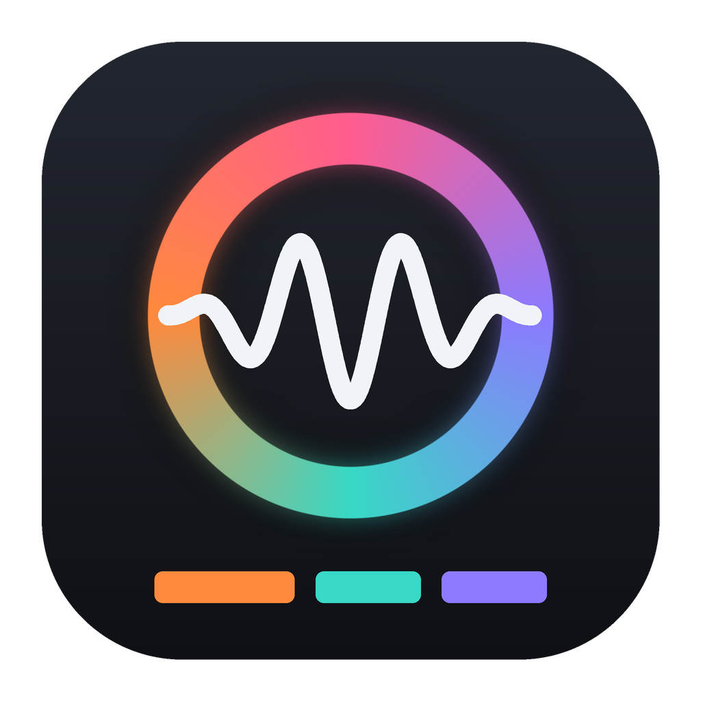
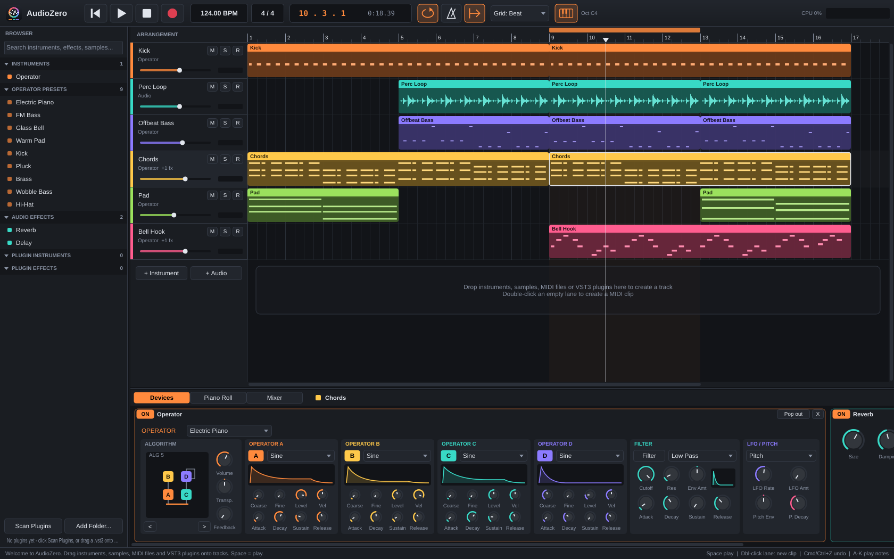
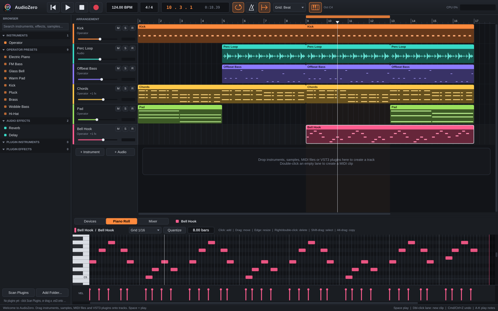
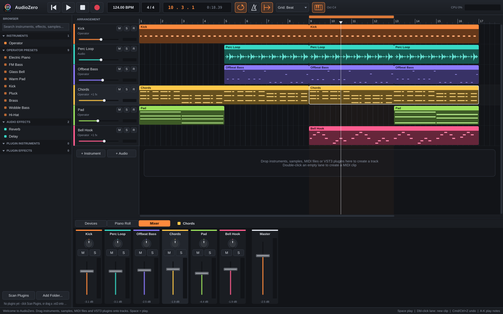

# AudioZero

**NOISYLOOP's native C++ digital audio workstation.** It's built with JUCE: one codebase for macOS, Windows and Linux.

*Real screenshot of the current build with the built-in demo song. The bottom panel shows Operator on the "Chords" track.*

| Piano roll | Mixer |
| --- | --- |
|  |  |

## What's in this build

- **Arrangement view** (Ableton / Bitwig / FL style)
  - Tracks with mute, solo, arm, volume and meters.
  - A bar ruler with a draggable loop brace.
  - Snap grid, zoom (Cmd/Ctrl + wheel or pinch) and a follow-playhead option.
  - Clips:
    - Double-click an empty lane to create a MIDI clip.
    - Drag to move, also across tracks. Drag the edges to trim. Alt-drag copies.
    - Split, duplicate, copy/paste, rename, colour and mute.
  - Every edit can be undone and redone.
- **Bring your own content**
  - Drag your **audio files** (wav, aif, flac, mp3, ogg) or **MIDI files** from Finder/Explorer onto a track. You can also drag them from the browser's sample folders, where clicking a sample previews it.
  - Drag a **`.vst3` bundle** straight onto a track or the device chain. Instruments go into the instrument slot and effects are added to the chain.
  - Scanned plugins appear in the browser, where you can drag them or double-click them.
  - Dropping anything below the last track creates a new track.
- **Operator**, a built-in 4-operator FM synth:
  - 8 algorithms with a live diagram.
  - Per operator: waveform, coarse/fine ratio, level, velocity and an ADSR envelope.
  - Feedback.
  - A low/high/band-pass filter with its own envelope.
  - An LFO that can modulate pitch, filter, volume or FM amount.
  - A pitch envelope for kicks and zaps.
  - 16 voices, sustain pedal, and 10 presets.
  - It also builds as a **standalone VST3 plugin** ("AudioZero Operator") you can use in other DAWs.
- **Built-in effects:** Reverb and a stereo/ping-pong Delay.
- **Piano roll**
  - Click to draw notes. Drag to move or resize.
  - Right-click or double-click deletes a note. Shift-drag selects.
  - Alt-drag copies. Q quantizes. Up/Down transposes. There's a velocity lane.
- **Mixer** with volume, pan, mute, solo and meters on every track and the master.
- **Transport**
  - Play/stop, loop, metronome, and tempo/time signature (drag or double-click to type).
  - MIDI recording from hardware controllers or the **computer keyboard**: A-K play notes, Z/X change octave, C/V change velocity.
- **Projects** save as `.azproj` (XML, with plugin state). Audio generated in memory is saved next to the project. **Export to WAV** renders offline.
- Hosted plugins receive tempo, position, play state and loop points, so tempo-synced effects work. Every MIDI input is enabled automatically.

See **Help > Keyboard Shortcuts** in the app for the full list.

## Your own VST3 plugins

AudioZero hosts VST3 through JUCE, so plugins built with JUCE work, for example Kick Me, GrainBrain and The Blucher. There are three ways to add one:

1. Drag the `.vst3` from Finder/Explorer onto a track or onto the bottom device panel.
2. Click **Scan Plugins** in the browser. To add your own build folder, use **Add Folder... > Add VST3 plugin folder**.
3. Click **+ Add Effect** / **Choose Instrument...** in the device panel and pick **Browse for a .vst3 file...**.

Click **Open Editor** on a plugin's device card to show its own UI. Plugin state is saved inside the project.

The test suite checks this path by building the Operator VST3, then loading it through AudioZero's host. The test plays a MIDI clip with it, saves the project and reloads it.

## Building

All platforms fetch JUCE 8.0.10 automatically, which needs internet access the first time.

| Platform | Requirements | Command |
| --- | --- | --- |
| macOS | Xcode, CMake | `bash scripts/build-mac.sh` |
| Windows | Visual Studio 2022 or newer (C++ workload), CMake | `powershell scripts/build-windows.ps1` |
| Linux | CMake, Ninja, ALSA/X11/freetype dev packages (listed in the script) | `bash scripts/build-linux.sh` |

Each build produces:

- the app, `AudioZero(.app/.exe)`;
- the plugin, `AudioZero Operator.vst3`, plus a standalone Operator app;
- the test runner, `AudioZeroCoreTests`.

`scripts/screenshots.sh` regenerates the README screenshots from the real app. Under the hood it runs `AudioZero --screenshot out.png --tab devices|pianoroll|mixer`.

`resources/icon.png` is a placeholder icon generated by `scripts/make-icon.py`. Replace the PNG with your own; CMake turns it into the `.icns` and `.ico` files.

## Continuous integration

| Workflow | Runs on | What it does |
| --- | --- | --- |
| `mac-build.yml` | macOS, on `main` and manual runs only | Build, all tests (including the VST3 host smoke test), unsigned DMG, Operator VST3 artifact |
| `ci.yml` | Windows + Linux, on `main` and pull requests | Build, all tests, app + VST3 artifacts, Linux UI screenshot |

macOS minutes count 10x against the GitHub Actions allowance, so pull requests are checked on Windows and Linux only. To build a branch on macOS, use **Actions > macOS build and DMG > Run workflow**.

## Status and known limitations

This is an early but working DAW. Not done yet:

- No audio input recording; MIDI recording works.
- No automation lanes, clip launcher (session view) or time-stretching. Audio clips play at their original speed.
- Plugins run in the same process, so a crashing plugin crashes AudioZero. Sandboxing is planned.
- No plugin delay compensation.
- Only VST3 is hosted (no AU yet).
- Undo covers arrangement edits. Device add/remove isn't undoable yet.
- The macOS and Windows builds are unsigned.
- MCP / AI control isn't started yet. The `Session` class holds every editing operation (add track, create clip, load a device, and so on) in one place, which is where an MCP server would plug in.

## Roadmap

1. **Hardening:** trust plugins by identity instead of the path in the project file, validate project and audio input, plugin sandboxing, latency compensation, crash recovery and autosave, signed installers. See [docs/SECURITY_REVIEW.md](docs/SECURITY_REVIEW.md) for the findings and the prioritised plan.
2. **Workflow:** automation, clip launcher, audio recording, warping, sampler and drum rack, more built-in effects.
3. **MCP server:** expose `Session` operations so an assistant can build and edit songs.

## Commercial licensing

AudioZero is intended to be proprietary commercial software, and no open-source license is granted for this repository. Review JUCE's commercial licensing terms before you distribute a product. Third-party plugins keep their own licenses.
