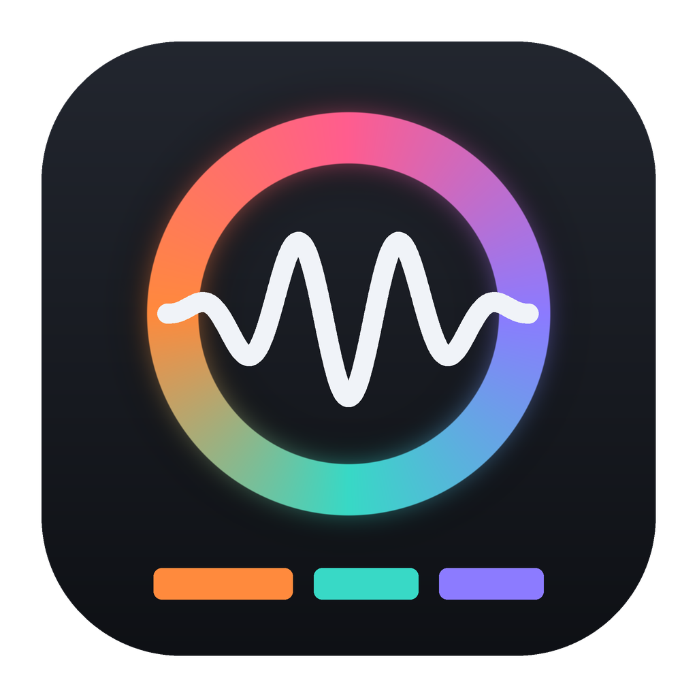
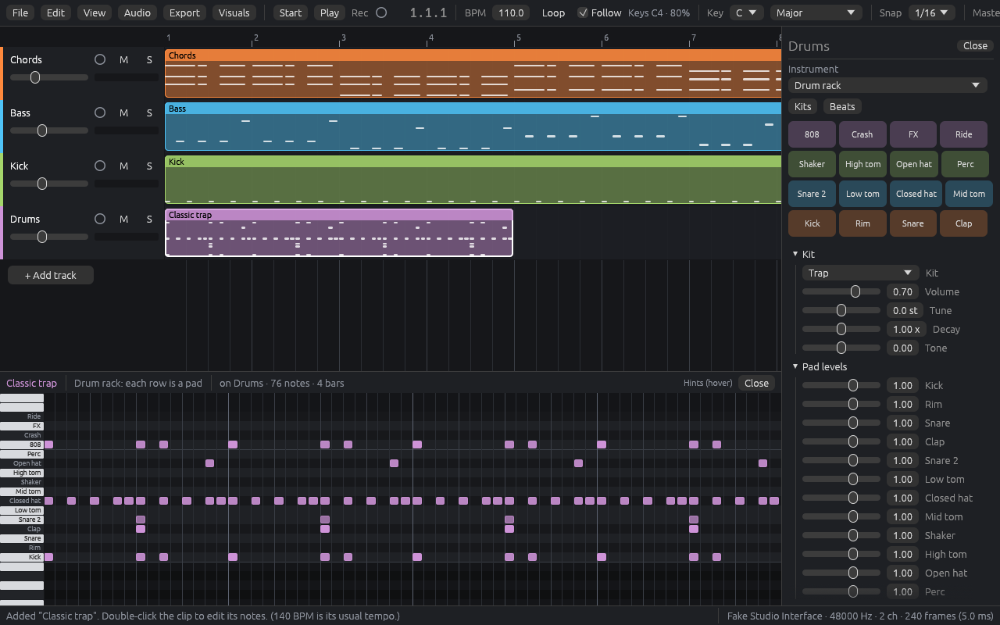
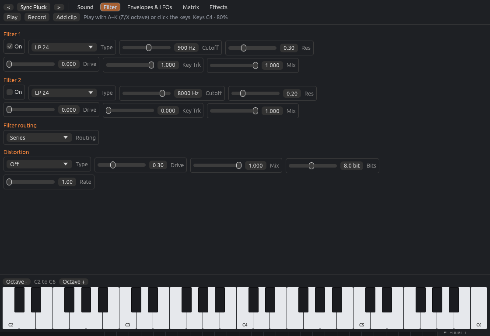
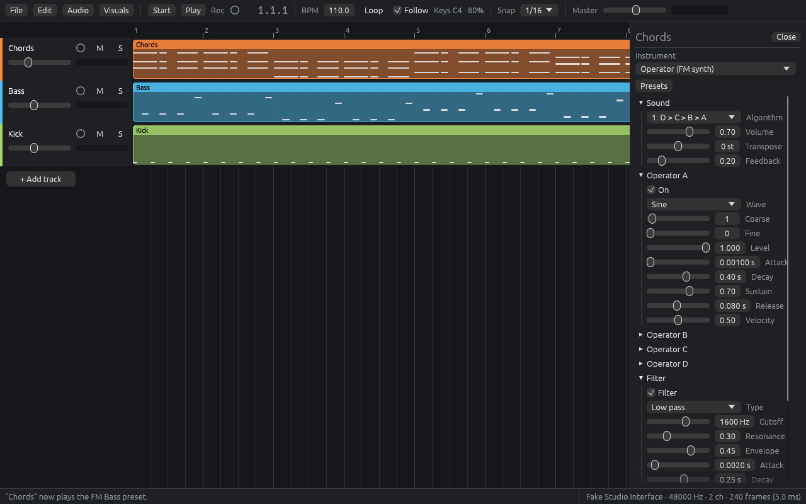
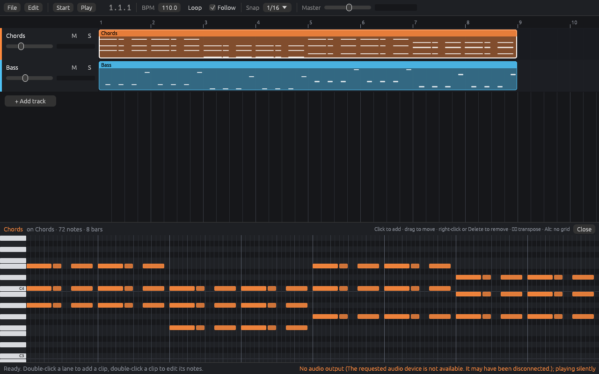
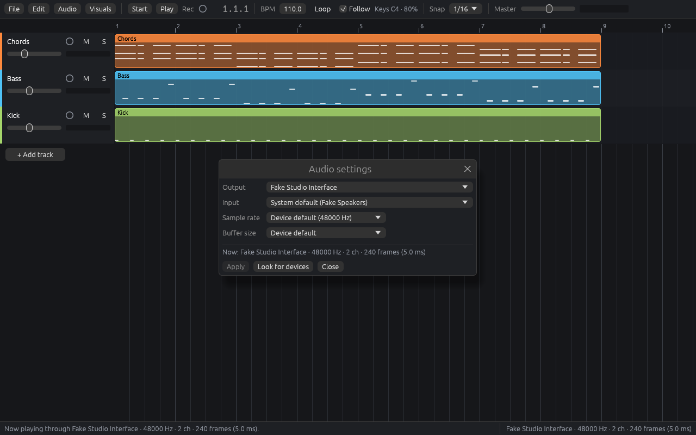
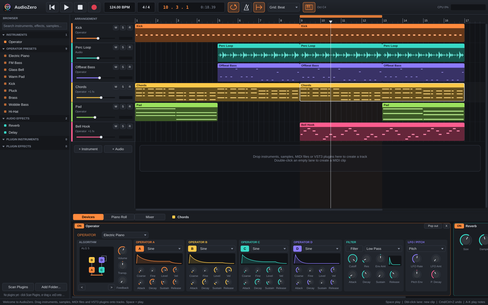
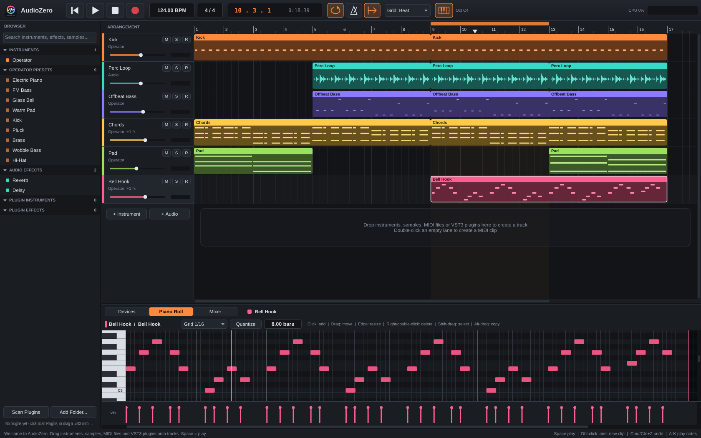
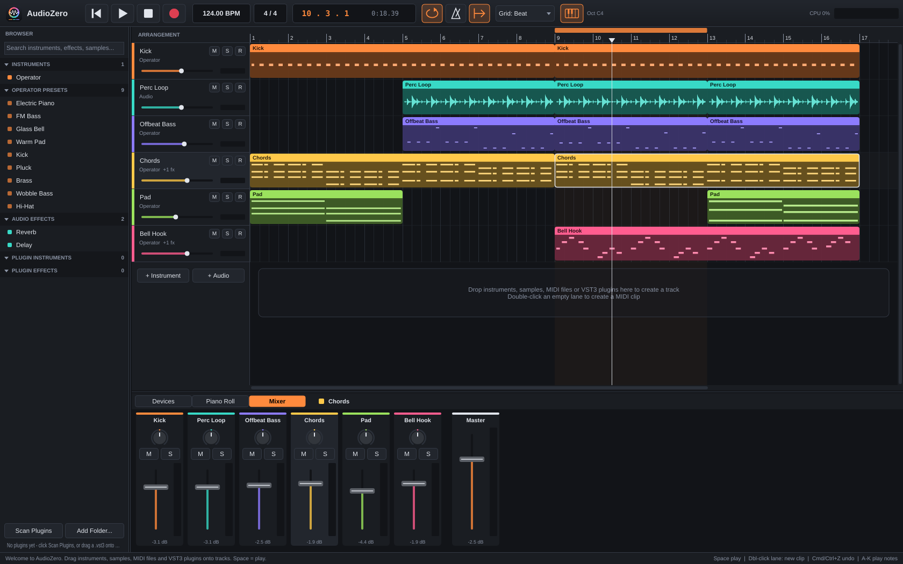

<p align="center"></p>

# AudioZero

**A digital audio workstation written in Rust.** One small program for Windows, macOS and Linux, with no sample libraries to download:

- an arrangement view and a piano roll that knows the song's key (with **Randomize** for instant in-key melodies);
- built-in instruments: **Soundgineer** (a wavetable synth with 59 presets plus 72 generated ones, in its own window), **Operator** (FM), a **drum rack** with nine kits (techno, house, dubstep, hip hop, lo-fi, trap, drum & bass, halftime and jazz) and 53 ready-made beats, and **Kick Me**;
- effects, recording from MIDI and audio inputs, and a choice of sound card;
- **WAV and MP3 export**, and audio-reactive video export;
- an **MCP server**, so an AI assistant can build and edit songs while you listen;
- three colour schemes: Dark, Darker and Light.

It's early but working. [Download a build](#download-a-build) or [build it yourself](#build-it-yourself).

<p align="center">
  <a href="https://github.com/noisyloop/AudioZero/releases/latest/download/audiozero-windows-x64.zip"></a>
  <a href="https://github.com/noisyloop/AudioZero/releases/latest/download/audiozero-macos-arm64.zip"></a>
  <a href="https://github.com/noisyloop/AudioZero/releases/latest/download/audiozero-linux-x64.zip"></a>
  <br><sub>Latest release: <a href="https://github.com/noisyloop/AudioZero/releases/latest">notes and checksums</a></sub>
</p>



| Soundgineer, in its own window | Operator |
| --- | --- |
|  |  |

*Real screenshots, taken on a machine with no sound card.*

> **Looking for the C++ / JUCE app?** AudioZero started as a C++ app built with JUCE. It's still here, and it's still the only version that can host third-party VST3 plugins, but new work happens in the Rust app. See [The original C++ app](#the-original-c-app-juce).

## What's in the app

- **The window:** the arrangement view (tracks, clips with a preview of their notes, bar ruler, playhead), play/stop, tempo, loop, snap, master volume and per-track mute, solo and volume with level meters.
- **Instruments:** **Operator**, a sine synth and Nusick's **Kick Me**, built in from [Nusick](https://github.com/noisyloop/Nusick)'s `nusick-dsp` crate (no plugin needed). Right-click a track's header to choose its instrument, or click the track's name and pick it in the device panel. The demo song has a Kick track.
- **Operator** is the 4-operator FM synth from the C++ app, ported:
  - 8 algorithms, feedback, and per operator a waveform, coarse/fine ratio, level, velocity and an ADSR envelope.
  - A low/high/band-pass filter with its own envelope, a pitch envelope, and an LFO for pitch, filter, volume or FM amount.
  - 16 voices and the same 10 presets (**Presets** in the device panel): Electric Piano, FM Bass, Glass Bell, Warm Pad, Kick, Pluck, Brass, Wobble Bass, Hi-Hat and Init.
  - Every setting is in the device panel, in sections you can fold. Changes are heard while it plays, saved in the project and undoable; a preset is one undo step.
  - Not ported yet: the algorithm diagram and the sustain pedal.
- **Soundgineer** is the wavetable synth from [noisyloop/soundgineer](https://github.com/noisyloop/soundgineer), ported to Rust:
  - Three wavetable oscillators (six built-in tables, generated at start-up, matching the original sample for sample), each with up to 16 unison voices, morph, detune, blend, stereo spread, start phase and hard sync; a sub and a noise oscillator.
  - Two filters in series or parallel (12/24 dB low, high, band pass, notch, comb and vowel formant), a distortion section, six envelopes, eight LFOs, four macros, and a rack of eight effects (chorus, phaser, flanger, delay, reverb, EQ, compressor, distortion). The LFOs and the delay can follow the song's tempo. Each LFO has a drawable curve (click to add points, drag to move or bend, right-click a point to delete, or start from a template), and you can drag any modulation source (envelopes, LFOs, macros, velocity...) from the strip at the top of the window onto a control to make it move, then right-click the control to set the depth.
  - A modulation matrix with 16 slots: any of 24 sources to any of 112 targets.
  - The 59 factory presets, by category (**Presets** in the device panel, or in its own window).
  - **Your own presets:** **Save / Import** in the editor's top bar saves the current sound as a JSON file in `presets/soundgineer` next to the settings (`~/.config/audiozero` on Linux), and imports a preset file with a file picker (**Choose file…**), by path, or by dropping it on the window. **Export current sound…** saves one anywhere. They show up under **My presets**. Files are checked as they're read: a preset must be a small `.json` file with the right format tag, only Soundgineer's own parameter names are kept, values must be numbers and are fitted to their range, and an imported file is written out again from the checked data, never copied. Saving never replaces a file, and names can't turn into paths. Applying a preset is one undo step.
  - **More presets:** 72 generated presets (12 each of bass, leads, pads, plucks, keys and FX) under **More presets**, made by `scripts/soundgineer/make_presets.py` and checked by a test that renders every one.
  - **Wavetable view:** the Sound page draws each oscillator's table in 3D (all 32 frames, with the frame Morph is on highlighted).
  - **Open editor** in the device panel opens Soundgineer in **its own window**: every control on five pages, the preset browser, and a four-octave keyboard you can play with the mouse or the computer keyboard (A–K). **Record** puts what you play into a clip, and **Add clip** makes an empty one and opens it in the piano roll.
  - The parameters and presets are generated from the original's source (`scripts/soundgineer`), so the two stay in step.
  - Not ported: importing your own wavetables and the noise sample slot, reordering the effects, the sustain pedal, and the scope and the modulation-aware wavetable view (the 3D view shows the Morph knob's own value).

  
- **Drum rack** (**Drum rack** in the instrument list): 16 synthesized pads on the General MIDI drum notes 36–51 (kick, rim, snare, clap, toms, hats, shaker, perc, 808, crash, FX, ride), with nine kits: **techno, house, dubstep, hip hop, lo-fi, trap, drum & bass, halftime and jazz**. Nothing is sampled, so it adds almost nothing to the download. Kit, volume, tune, decay, tone and a level per pad are in the device panel, which also has a 4×4 pad grid to play with the mouse (the computer keyboard plays the pads too). The closed and open hi-hats choke each other.
  - **Ready-made beats:** 53 of them, five or six per genre, from four-on-the-floor to amen-style breaks, halftime and swung jazz ride patterns. **Edit > Add drum track with beat** makes a drum track with the right kit and the beat as a clip; the device panel's **Beats** menu adds one to an existing drum track. In an empty song the tempo follows the beat. Beats are ordinary clips, so you can edit them in the piano roll, where each row is labelled with its pad.

  
- **Audio clips:** drag audio files (wav, aif, flac, mp3, ogg) from your file manager onto a track, or below the last track to get a new track. Several files at once go one after another. Audio clips show their waveform and play at the file's own speed (no time-stretching yet). They move, resize, duplicate, mute and undo like MIDI clips. Files inside the project's folder are stored with relative paths, so the folder can be moved.
- **Effects:** click a track's name to open its device panel on the right. Choose the instrument, add **Delay** (ping-pong), **Reverb** or **Compressor** with **+ Add effect**, and set their parameters with sliders. Changes are heard straight away without interrupting playback. Adding, removing and changing effects can be undone; a whole slider drag is one step.
- **Sound card:** **Audio > Audio settings** (or a click on the device name in the status bar) chooses the output and input device, the sample rate and the buffer size.
  - **Apply** switches straight away and keeps the song, the playhead and whether it's playing. The choice is saved for next time, and `--play` and `--mcp` use it too.
  - The buffer size is shown in frames and milliseconds. A smaller buffer means less delay when you play; if the sound crackles, choose a larger one. The window counts the crackles the sound card reports.
  - **Look for devices** finds an interface you've just plugged in.
  - If the device is unplugged, AudioZero carries on with the system's default device, or silently if there is none, and says so. If the saved device isn't connected at startup, it uses the default and keeps your choice for when it's back.
  - It uses the system's normal audio: WASAPI on Windows, Core Audio on macOS and ALSA on Linux (which also reaches PipeWire and PulseAudio). ASIO and JACK aren't supported yet.
- **Playing and recording:**
  - Every MIDI input is connected at startup. Notes go straight to the audio thread, so playing doesn't wait for the window.
  - The computer keyboard works as a MIDI keyboard: A–K play notes (W, E, T, Y, U are the black keys), Z/X change octave and C/V change velocity.
  - Live notes play the armed track, or else the track you're editing or have selected.
  - Arm a track with its ● button and press **R** (or the Rec button) to record; recording starts playback if it's stopped. Press R again, or stop, to finish the take. A loop wrap ends it too.
  - A track with an instrument records MIDI into a new clip that covers whole bars. A track without an instrument records audio from the input chosen in the audio settings (the system's default input unless you pick one) as a 24-bit WAV in the project's `Recordings` folder (`~/Music/AudioZero/Recordings` if the project hasn't been saved), then adds it as an audio clip.
  - A take is one undo step. There's no input monitoring or latency compensation yet.
- **Clip editing:** click to select, drag to move (also onto another track), drag the right edge to resize, double-click an empty lane to add a clip, and right-click for Edit notes, Duplicate, Mute and Delete. Add tracks with **+ Add track** and remove them by right-clicking a track's header.
- **Export:** the **Export** button (or **File > Export audio**) renders the whole song or the loop range to a **WAV** (16 or 24-bit) or an **MP3** (128 to 320 kbps, through FFmpeg) at 44.1, 48 or 96 kHz. It runs in the background with progress and Cancel, writes to a temporary file that's renamed into place only when it's finished, and never replaces a file unless you tick Replace. The reverb and delay tails are included (a 2 second tail after the last clip).
  - **Song info (optional):** the export window has a collapsed **Song info** section for the credits and identifiers a release carries: title, artist, album artist, album and track, release date, genre, composer, lyricist, producer, mixed by, label, **ISRC**, **UPC/EAN**, **ISWC**, the **©** and **℗** lines, language and an explicit flag. Leave it closed and nothing changes. It's saved with the song, checked as you type (an ISRC, barcode, ISWC or date that isn't valid stops the export and says why), and the song's tempo and key are added automatically. In a **WAV** it's written three ways, so different software can find it: an `id3 ` chunk (ID3v2.4, read by foobar2000, MusicBrainz Picard, Reaper and most tag editors), a `LIST`/`INFO` chunk (the basic fields Windows and many players read) and an EBU Tech 3285 `bext` chunk (what broadcast and archive tools read). In an **MP3** it's an ID3v2.4 tag. Distributors usually take the credits from their own form, so this is mainly for your own files, players and archives; Apple Music, for one, doesn't read tags from WAV files at all.
- **Colours:** **View > Colours** switches between **Dark**, **Darker** and **Light**, and remembers the choice.
- **Piano roll:** double-click a clip to edit its notes:
  - click to add a note, or drag from an empty spot to draw one at the length you want;
  - drag notes to move them, and drag a note's right edge to change its length;
  - Shift-click to select several notes, Ctrl/Cmd + A to select all;
  - drag across an empty area to select the notes inside the box (Shift adds to the selection), or Ctrl/Cmd-drag from an empty spot to draw a note;
  - right-click or Delete to remove, Up/Down to transpose (Shift moves an octave);
  - Ctrl/Cmd + D duplicates the selected notes to straight after them (and selects the copies, so pressing it again carries on);
  - **Key and scale:** the song's key is chosen in the top bar or the piano roll (twelve keys; major, minor, the church modes, harmonic and melodic minor, pentatonics, blues or chromatic). The roll dims notes outside the scale, **In key** keeps new and moved notes on it, and **Randomize** writes a new melody in key (or new pitches for the selected notes), a different one each press. Undo brings the old notes back.
- **Track names:** click a track's name to select it (its header is tinted, and the device panel opens). **Ctrl/Cmd + R**, double-clicking the name, or right-click > **Rename** renames it.
- **Effects:** **EQ** (four bands, with a curve you can drag: each node sets a band's frequency and gain, and scrolling over a bell changes its width), compressor, delay, reverb, **chorus**, **phaser**, **bit crusher** and **distortion** (soft clip, hard clip, wavefold). Add them from **+ Add effect**.
- **Glitch:** an effect for the trippy, stuttering sound of glitch-hop and IDM. On a grid you choose (1/4 to 1/32, one to four steps long) it decides, by chance, to **stutter** (accelerating buffer repeats), play the recent past **in reverse**, **tape-stop**, **gate** the sound, **bit-crush** it, or repeat a slice at a different **pitch**. **Amount** is how often, **Seed** picks a different pattern, and each kind can be switched off. The pattern depends only on the song position and the seed, so an export sounds exactly like what you heard, and playing from anywhere gives the same glitches. It works on any track, and it follows the tempo.
- **Arpeggiator:** every track with an instrument has one in the device panel. It turns the notes the track plays, from clips or live, into a pattern: up, down, up and down, random, as played or chord, at 1/4 to 1/32 (with triplets), over one to four octaves, with gate and swing. It's sample-accurate and follows the tempo.
- **Clip fades:** hover a clip and drag the small handles at the top corners to fade the track in at the clip's start or out at its end (or right-click the clip: **Fade in** / **Fade out**). The fade is drawn on the clip. It acts on the whole track after its effects, so reverb and delay tails fade too, and after a fade-out the track stays silent until its next clip. Fades are click-free and are in exports. The assistant has `set_clip_fades`.
- **Copy and paste tracks:** select a track and press **Ctrl+C**, select another and press **Ctrl+V** to paste an independent copy after it (instrument, settings, effects and clips; a group comes with everything inside it). It's a new track you can edit without touching the original. Also in the track's right-click menu.
- **Groups:** select a track and press **Ctrl+G** to put it in a group (**Ctrl+Shift+G** takes it back out, or ungroups a group). Drag a track's name onto a group to move it in, or drop it below the last track to leave. Rename a group with **Ctrl+R** or right-click like any track. A group mixes the tracks inside it, has its own volume, mute and solo, and runs its own effects (EQ, compressor, glitch and the rest) on that mix. Groups can hold groups. The assistant can use them too (`group_track`, `move_to_group`, `ungroup`).
- **Grid:** snap to bars, 1/4, 1/8, 1/16 or 1/32, or turn it off. Holding Alt ignores the grid.
- **Undo:** every clip, note, track and instrument edit can be undone and redone (Ctrl/Cmd + Z, Ctrl/Cmd + Shift + Z or Ctrl + Y). A whole drag is one step. Mixer and tempo changes aren't undo steps, and undoing an edit leaves them as they are. All edits go through one `Session` (in the engine crate), which the MCP server uses too.
- **Editing while playing:** an edit swaps in just that track's clips, so playback carries on. Adding or removing a track rebuilds the engine and keeps the playhead where it was. Every edit gets the same validation as a project file.
- **Navigation:** click or drag the ruler to move the playhead; Ctrl/Cmd + wheel or pinch zooms; the wheel scrolls (Shift for sideways).
- **Shortcuts:** Space plays and stops, Home goes back to the start, Ctrl/Cmd + S saves, Ctrl/Cmd + O opens, Ctrl/Cmd + D duplicates the selected clip (or, in the piano roll, the selected notes). A copied clip goes after any clips in the way, never on top of them.
- **Projects:** open, save and save-as. Projects are saved as **`.azproj`** (JSON inside, so they're easy to read and diff), and `.json` projects still open. Drag a project onto the window to open it, and AudioZero asks before throwing away unsaved changes.
- **No sound card:** the app still runs, and the playhead moves without sound.




*Operator on the Chords track with the FM Bass preset.*



*The Audio settings window after switching output. It was captured on a machine with no sound card, using two stand-in devices ("Fake Speakers" and "Fake Studio Interface").*

## Crates

The Rust workspace is split so each part can be used and tested on its own.

| Crate | What it is |
| --- | --- |
| `crates/audiozero-engine` | The audio engine and project format, with no UI or platform code. Projects are JSON, and every project is checked against fixed limits and ranges before the engine sees it. Audio files are opened only after a path check (no network paths, no `..` out of the project folder, audio extensions only) and decoded with size, length and memory caps. Rendering is sample-accurate. The audio thread never allocates, frees, locks or waits: the UI sends commands through a lock-free queue, and a new project is built on the UI thread and swapped in whole. Includes the built-in instruments (Operator, a small sine synth, Kick Me) and a demo song. |
| `crates/audiozero-visuals` | Audio-reactive visuals: per-frame analysis of the rendered song and its notes, the built-in looks, and video/PNG export (MP4 is built in). No UI or GPU, so it runs headless. |
| `crates/audiozero-mcp` | The MCP server: every tool is a `Session` operation, so an assistant's edits get the same checks and undo as yours. Speaks MCP over stdio, with no dependencies beyond `serde_json`. See [AI control (MCP)](#ai-control-mcp). |
| `crates/audiozero-host` | Finds CLAP and VST3 plugins and resolves projects' plugins by identity, never by a path stored in the project. It doesn't load plugin code yet; that will happen in a separate process. |
| `crates/audiozero-app` | The `audiozero` app: the window, sound card and MIDI input, plus command-line options to play, render to WAV, save the demo project, list sound cards or installed plugins, or run the MCP server. |

## Download a build

The latest release, no GitHub account needed:

| System | Download |
| --- | --- |
| Linux, x86-64 | [audiozero-linux-x64.zip](https://github.com/noisyloop/AudioZero/releases/latest/download/audiozero-linux-x64.zip) |
| Windows 10/11, x86-64 | [audiozero-windows-x64.zip](https://github.com/noisyloop/AudioZero/releases/latest/download/audiozero-windows-x64.zip) |
| macOS, Apple silicon | [audiozero-macos-arm64.zip](https://github.com/noisyloop/AudioZero/releases/latest/download/audiozero-macos-arm64.zip) |

Checksums are in [SHA256SUMS.txt](https://github.com/noisyloop/AudioZero/releases/latest/download/SHA256SUMS.txt), and older versions are on the [Releases](https://github.com/noisyloop/AudioZero/releases) page.

To publish a release, open [Actions > Rust workspace](https://github.com/noisyloop/AudioZero/actions/workflows/rust.yml), click **Run workflow**, pick the branch and fill in **Publish a release with this tag** (for example `v0.6.0`). It builds all three systems, macOS included, and publishes them as a GitHub Release.

Builds from any run (without a release) are under that run's **Artifacts**:

1. Open [Actions > Rust workspace](https://github.com/noisyloop/AudioZero/actions/workflows/rust.yml) and click a green run. The [first run with downloads](https://github.com/noisyloop/AudioZero/actions/runs/42753120183) is an example.
2. Under **Artifacts** at the bottom of the run's page, download the file for your system. You need to be signed in to GitHub, and downloads expire after 90 days.

| Artifact | System | Run it |
| --- | --- | --- |
| `audiozero-linux-x64` | Linux, x86-64 | `chmod +x audiozero && ./audiozero` |
| `audiozero-windows-x64` | Windows 10/11, x86-64 | Double-click `audiozero.exe`. SmartScreen warns because it's unsigned: choose **More info > Run anyway**. |
| `audiozero-macos-arm64` | macOS on Apple silicon | `chmod +x audiozero && xattr -d com.apple.quarantine audiozero && ./audiozero` in Terminal. It's unsigned, and the first recording asks for microphone access. |

Each download is a zip containing the program. The command-line options below work with it too, for example `./audiozero --mcp song.azproj`.

To make a new build, open the workflow, click **Run workflow** and pick a branch. Tick **Also build on macOS** only when you need it: macOS minutes count 10x against the Actions allowance.

## Build it yourself

```sh
cargo run --release -p audiozero-app                          # open the window with the demo song
cargo run --release -p audiozero-app -- song.azproj           # open a project
cargo run --release -p audiozero-app -- --play                # play from the command line, no window
cargo run --release -p audiozero-app -- --render demo.wav     # render to WAV
cargo run --release -p audiozero-app -- --save demo.azproj    # write the demo as a project file
cargo run --release -p audiozero-app -- --scan                # list installed CLAP/VST3 plugins
cargo run --release -p audiozero-app -- --devices             # list sound cards and what they support
cargo run --release -p audiozero-app -- --play --output-device scarlett --rate 48000 --buffer 256
cargo run --release -p audiozero-app -- --mcp song.azproj     # MCP server for an AI assistant (see below)
cargo test --workspace                                        # all tests
```

`--output-device`, `--input-device`, `--rate` and `--buffer` work with the window, `--play` and `--mcp`. A device is an id from `--devices`, or a name or part of one. They apply to that run only; the window's Audio settings are what's saved, in `settings.json` under `~/.config/audiozero` (Linux), `~/Library/Application Support/AudioZero` (macOS) or `%APPDATA%\AudioZero` (Windows).

On Linux, building needs the ALSA headers (`libasound2-dev`), and running the window needs an OpenGL driver and `libxkbcommon-x11-0`. Desktop installs normally already have them. The direct dependencies are `nusick-dsp` (Nusick's DSP, pinned to a commit), `serde`/`serde_json` (project files), `symphonia` (pure-Rust audio file decoding), `rtrb` (the lock-free command queue), `cpal` (audio input and output), `midir` (MIDI input) and `eframe`/`egui` (the window).

## Audio-reactive visuals

AudioZero has a built-in VJ. **Visuals > Show live visuals** opens a window that reacts while the song plays; put it on a second screen and press F11 (or double-click) for full screen. **Visuals > Export video…** renders a music video of the song or the loop, with its audio, in the background while you keep working (with progress and Cancel). An assistant can export too, with the MCP tool `export_video`.

The visuals react to the audio (loudness, bass/mid/treble, a 32-band spectrum, kicks) and to the song itself: every note on every track, and where the beat and bar are. A VJ app that only listens to the audio can't know any of that.

From the command line:

```sh
audiozero song.azproj --video song.mp4                                  # whole song, 1920x1080, 30 fps
audiozero song.azproj --video short.mp4 --format shorts --look rings    # 9:16 for Shorts, Reels, TikTok
audiozero song.azproj --video frames/ --format square --fps 60          # PNG frames + audio.wav
audiozero song.azproj --video loop.webm --loop --look particles         # just the loop range
audiozero song.azproj --still preview.png --at 12                       # one frame, to try a look
```

- **Looks:** `spectrum` (mirrored bars over a bass glow), `rings` (one ring per track, pulsing with its notes, hue from the pitch) and `particles` (a burst for every note: across by pitch, up and down by track).
  More visuals were added: six raymarched 3D fractals (`fractal-mandelbulb`, `fractal-menger`, `fractal-sierpinski`, `fractal-apollonian`, `fractal-kali` and `fractal-tetra`). The camera orbits as the song plays, the fold breathes with the bass, kicks pull the camera in and brighten the surface, and the colours turn once a bar. They're drawn at a reduced resolution and scaled up, so they're softer than the other looks and slower to export.
- **Formats:** `widescreen` (1920×1080), `shorts` (1080×1920), `square` (1080×1080), `portrait` (1080×1350), `4k` (3840×2160), or any even `WIDTHxHEIGHT`.
- **Files:** `.mp4` (H.264 + AAC, with the song's audio) is made by AudioZero itself, so it works on any machine with nothing else installed, and is ready to upload to YouTube, Instagram, TikTok and the like. `.mov`, `.mkv` (H.264 + AAC) and `.webm` (VP9 + Opus) go through [FFmpeg](https://ffmpeg.org), which they need on your `PATH`. Any other path is treated as a folder of PNG frames plus `audio.wav`.

Export renders offline, frame by frame, so the video is always in sync and the same project gives the same video. It's drawn on the CPU, spread over all cores: a 20-second song took about 16 seconds at 1080p on a 4-core cloud machine. Custom shaders (on the GPU) and a node graph come next; see the roadmap.

## AI control (MCP)

`audiozero --mcp [PROJECT]` runs an [MCP](https://modelcontextprotocol.io) server on stdin/stdout, so an assistant such as Claude can build and edit a song while you listen. It edits `PROJECT` (an existing `.azproj` or `.json` project, or a new one that's created on the first save), or an empty song if none is given, and plays through your speakers.

To use it from Claude Code (build with `cargo build --release` first):

```sh
claude mcp add audiozero -- /path/to/AudioZero/target/release/audiozero --mcp ~/Music/AudioZero/my-song.azproj
```

Other MCP clients take the same command and arguments in their server configuration.

The tools:

- **Read:** `get_project`, `get_clip` and `list_instruments`.
- **Tracks:** `add_track`, `remove_track`, `rename_track`, `set_instrument` and `set_track_mix`.
- **Instrument settings:** `set_instrument_param` and `set_instrument_preset`, for Operator, the drum rack and Soundgineer (`list_instruments` lists their parameters and presets).
- **Effects:** `add_effect`, `remove_effect` and `set_effect_param` (`list_instruments` lists the effects and their parameters).
- **Clips:** `add_clip` (optionally with notes), `update_clip`, `move_clip`, `duplicate_clip` and `remove_clip`.
- **Notes:** `add_notes`, `set_notes`, `remove_notes` and `transpose_notes`.
- **Song:** `set_transport` (tempo, loop, master volume), `undo`, `redo`, `play`, `stop` and `save`.
- **Drums and key:** `add_drum_beat` (a ready-made beat on a new or existing drum track; `list_instruments` lists the beats, the kits and the pads) `set_key`, and `set_song_info` (the credits and identifiers written into exports).
- **Export:** `export_audio` (WAV or MP3, song or loop) and `export_video` (look, format, fps, song or loop, MP4/WebM/PNG frames), each into a new file in `~/Music/AudioZero`.

It follows the rules in [docs/SECURITY_REVIEW.md](docs/SECURITY_REVIEW.md#before-the-mcp-server-ships):

- It uses stdio only and never opens a network port.
- No tool takes a file path. `save` writes to the project the server was started with. If there isn't one, it creates a new file under a plain name in `~/Music/AudioZero` and never replaces an existing file.
- Instruments are the built-in ones, chosen by id. Nothing loads plugin code.
- Every argument goes through the same checks as a project file. Bad values are refused with a message, not clamped silently. Messages and note lists have size caps.
- Every edit is an undo step, except mixer and transport settings, as in the window. Every call goes into an activity log on stderr, which MCP clients show in their server logs.
- `remove_track`, `remove_clip`, `set_notes`, `remove_notes` and `save` are marked destructive, so clients that ask for confirmation ask for those.

For now the server and the window are separate. Open the saved project in the window to keep working on it there.

## Continuous integration

Every build is manual for now: pushes, pull requests and merges don't start any workflow. To build, open **Actions**, pick a workflow, click **Run workflow** and choose the branch.

| Workflow | Runs on | What it does |
| --- | --- | --- |
| `rust.yml` | Linux, Windows (+ macOS on request) | **The Rust app:** format check, Clippy, tests, demo render, and release builds uploaded as downloads or published as a release (see [Download a build](#download-a-build)) |
| `ci.yml` | Windows + Linux | The original C++ app: build, all tests, app + VST3 artifacts, Linux UI screenshot |
| `mac-build.yml` | macOS | The original C++ app: build, all tests (including the VST3 host smoke test), unsigned DMG, Operator VST3 artifact |

macOS minutes count 10x against the GitHub Actions allowance, so run `mac-build.yml` only when you need a Mac build of the C++ app (the Rust workflow only builds on macOS when asked).

## Status and known limitations

This is an early but working DAW. Not done yet:

- **Third-party plugins don't load in the Rust app.** `audiozero-host` finds CLAP and VST3 plugins but doesn't run them. Hosting (out of process, so a crashing plugin can't take the app down) and a way to show each plugin's own UI come next. Until then, the C++ app is the one that hosts VST3.
- No automation lanes, clip launcher (session view) or time-stretching. Audio clips play at their original speed.
- No input monitoring, and no latency compensation for recorded takes or for plugins.
- Undo covers arrangement, instrument and effect edits. Mixer and tempo changes aren't undo steps.
- Sound cards go through the system's audio (WASAPI, Core Audio, ALSA). ASIO and JACK aren't supported.
- The built-in synths leave some things out compared with their originals: see the notes under **Operator** and **Soundgineer** above.
- The macOS and Windows builds are unsigned.
- MCP / AI control works on a project file, not on the open window's session: the server and the window don't share a live session yet (see [AI control (MCP)](#ai-control-mcp)).

## Roadmap

1. **Hardening:** trust plugins by identity instead of the path in the project file, validate project and audio input, plugin sandboxing, latency compensation, crash recovery and autosave, signed installers. See [docs/SECURITY_REVIEW.md](docs/SECURITY_REVIEW.md) for the findings and the prioritised plan.
2. **Workflow:** automation, clip launcher, warping, a sampler, more built-in effects and instruments. (Audio recording and the drum rack are done.)
3. **MCP server:** the first version is in the Rust app. Next: drive the open window's session live (with the activity log visible in the UI), give plugins by identity once hosting lands, and render previews the assistant can check.
4. **Plugins by others:** host CLAP and VST3 out of process, with a way to show each plugin's own UI, and offer [Nusick](https://github.com/noisyloop/Nusick) as the SDK for writing them, with a template and docs. The built-in synths' DSP can move into Nusick so they can also ship as plugins for other DAWs.
5. **Audio-reactive visuals (built-in VJ):** visuals driven by the arrangement's notes, beats and audio, shown live while playing and exported for the song's length (or the loop or a selection) as 16:9, 9:16 shorts, 1:1 or 4:5, in MP4/H.264, H.265, WebM, ProRes or PNG frames with the audio.
   1. ✅ Built-in looks, a live window, and export (rendered offline, frame-accurate). In v0.2.0.
   2. Your own shaders (WGSL, reloaded as you edit), mapping any sound feature to any parameter, and automatable visual parameters.
   3. A TouchDesigner-style node graph on `wgpu`, sandboxed visual plugins (shaders and WebAssembly), and a visual SDK in Nusick.

## The original C++ app (JUCE)

AudioZero began as a C++ app built with JUCE. It's still in this repository (`src/`, `CMakeLists.txt`) and still builds, and it is **the only version that can host third-party VST3 plugins today**. New features go into the Rust app, which will replace it once it can host plugins too (see the [roadmap](#roadmap)).



| Piano roll | Mixer |
| --- | --- |
|  |  |

### What's in the C++ build

- **Arrangement view** (Ableton / Bitwig / FL style)
  - Tracks with mute, solo, arm, volume and meters.
  - A bar ruler with a draggable loop brace.
  - Snap grid, zoom (Cmd/Ctrl + wheel or pinch) and a follow-playhead option.
  - Clips:
    - Double-click an empty lane to create a MIDI clip.
    - Drag to move, also across tracks. Drag the edges to trim. Alt-drag copies.
    - Split, duplicate, copy/paste, rename, colour and mute.
  - Every edit can be undone and redone.
- **Bring your own content**
  - Drag your **audio files** (wav, aif, flac, mp3, ogg) or **MIDI files** from Finder/Explorer onto a track. You can also drag them from the browser's sample folders, where clicking a sample previews it.
  - Drag a **`.vst3` bundle** straight onto a track or the device chain. Instruments go into the instrument slot and effects are added to the chain.
  - Scanned plugins appear in the browser, where you can drag them or double-click them.
  - Dropping anything below the last track creates a new track.
- **Operator**, a built-in 4-operator FM synth:
  - 8 algorithms with a live diagram.
  - Per operator: waveform, coarse/fine ratio, level, velocity and an ADSR envelope.
  - Feedback.
  - A low/high/band-pass filter with its own envelope.
  - An LFO that can modulate pitch, filter, volume or FM amount.
  - A pitch envelope for kicks and zaps.
  - 16 voices, sustain pedal, and 10 presets.
  - It also builds as a **standalone VST3 plugin** ("AudioZero Operator") you can use in other DAWs.
- **Built-in effects:** Reverb and a stereo/ping-pong Delay.
- **Piano roll**
  - Click to draw notes. Drag to move or resize.
  - Right-click or double-click deletes a note. Shift-drag selects.
  - Alt-drag copies. Q quantizes. Up/Down transposes. There's a velocity lane.
- **Mixer** with volume, pan, mute, solo and meters on every track and the master.
- **Transport**
  - Play/stop, loop, metronome, and tempo/time signature (drag or double-click to type).
  - MIDI recording from hardware controllers or the **computer keyboard**: A-K play notes, Z/X change octave, C/V change velocity.
- **Projects** save as `.azproj` (XML, with plugin state). Audio generated in memory is saved next to the project. **Export to WAV** renders offline.
- Hosted plugins receive tempo, position, play state and loop points, so tempo-synced effects work. Every MIDI input is enabled automatically.

See **Help > Keyboard Shortcuts** in the app for the full list.

### Your own VST3 plugins

AudioZero hosts VST3 through JUCE, so plugins built with JUCE work, for example Kick Me, GrainBrain and The Blucher. There are three ways to add one:

1. Drag the `.vst3` from Finder/Explorer onto a track or onto the bottom device panel.
2. Click **Scan Plugins** in the browser. To add your own build folder, use **Add Folder... > Add VST3 plugin folder**.
3. Click **+ Add Effect** / **Choose Instrument...** in the device panel and pick **Browse for a .vst3 file...**.

Click **Open Editor** on a plugin's device card to show its own UI. Plugin state is saved inside the project.

The test suite checks this path by building the Operator VST3, then loading it through AudioZero's host. The test plays a MIDI clip with it, saves the project and reloads it.

### Building the C++ app

All platforms fetch JUCE 8.0.10 automatically, which needs internet access the first time.

| Platform | Requirements | Command |
| --- | --- | --- |
| macOS | Xcode, CMake | `bash scripts/build-mac.sh` |
| Windows | Visual Studio 2022 or newer (C++ workload), CMake | `powershell scripts/build-windows.ps1` |
| Linux | CMake, Ninja, ALSA/X11/freetype dev packages (listed in the script) | `bash scripts/build-linux.sh` |

Each build produces:

- the app, `AudioZero(.app/.exe)`;
- the plugin, `AudioZero Operator.vst3`, plus a standalone Operator app;
- the test runner, `AudioZeroCoreTests`.

`scripts/screenshots.sh` regenerates the README screenshots from the real app. Under the hood it runs `AudioZero --screenshot out.png --tab devices|pianoroll|mixer`.

`resources/icon.png` is a placeholder icon generated by `scripts/make-icon.py`. Replace the PNG with your own; CMake turns it into the `.icns` and `.ico` files.
